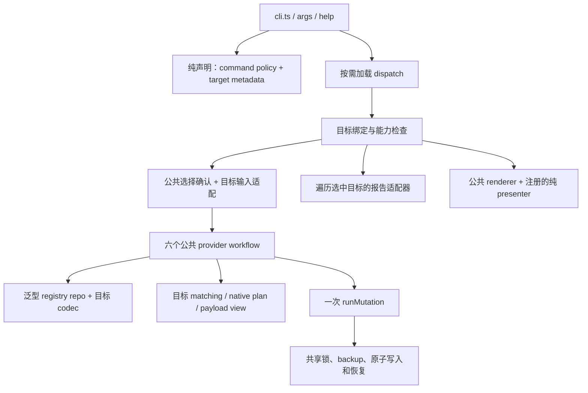

# agent-provider-switch v1.2.0 Technical Design

## 1. 状态、依据与实现基线

本文实现 [v1.2.0 PRD](../PRD/agent-provider-switch-prd-v1.2.0.md)，依据 [全局审查](../Reviews/agent-provider-switch-1.2.0-prd-review.md) 和已接受的 [ADR-0001](../adr/0001-share-provider-workflows-through-target-adapters.md)。状态为 **设计完成，待实现**；当前包版本仍是 `1.1.3`，源码审查基线 `1da0a60`。

本轮提取公共 provider 工作流与目标适配器，新增 selector，统一公共交互与报告编排。保留当前记录格式、正常业务语义、JSON 契约及共享锁/备份模型。[1.1.x 个人使用验收及暂缓记录](../Reviews/agent-provider-switch-1.1.x-implementation-verification.md) 是实际行为基线；本文不把旧 PRD 中尚未实现的边界重新纳入范围。

设计中的新路径和接口是实施约定，不表示文件已经存在。实施时可以调整小模块划分与私有类型名称，但必须满足职责边界和验收规则。

## 2. 架构与模块职责



描述符分成轻量声明和执行绑定。解析/help/纯 domain 只读取轻量声明；执行绑定组装 storage、app、interaction 和 presenter。两者按 id 关联，不把 fs、环境探测或 inquirer 放进 domain descriptor。

| 层与建议模块 | 职责 |
|---|---|
| `domain/target.ts` | TargetId、目标静态声明、规范化选择、命令选择策略和 capability 判断 |
| `domain/command.ts` | 纯 CommandId/TargetOperation 类型；commands/types 可 re-export，避免 domain 引用执行层 |
| `domain/provider-registry.ts` | `Registry<R>`、codec 类型；现有 providers/claude-providers 保留目标领域算法 |
| `storage/tool-home-paths.ts` | 一份工具目录、共享 config/lock/backups/latest；目标 registry 不作为共享路径必需字段 |
| `storage/provider-registry-repo.ts` | 公共读取、decode、查找、排序/encode、原子写回；无 effective resolution |
| `storage/codex-paths.ts`、`storage/claude-paths.ts` | 保留目标路径与环境优先级；旧路径 facade 按实际调用需求保留 |
| `app/provider-workflows.ts` | 六个泛型 workflow；registry 集合与 mutation 编排只有一份 |
| `app/targets/types.ts` | 泛型目标适配器、native plan、report port 等执行契约 |
| `app/targets/codex-adapter.ts`、`claude-adapter.ts` | native 读取/投影、defaults、matching、操作策略、payload view；可以继续拆小模块 |
| `commands/provider-handler.ts` | 公共名称解析、选择/确认和目标输入调用，随后调用公共 app workflow |
| `commands/target-bindings.ts` | 将两个具体泛型适配器绑定为可按 id 查找的执行描述符；只有这里组装具体目标 |
| `commands/registry.ts`、`dispatch.ts`、`flag-guards.ts` | 共享命令声明、能力检查、按需加载和执行；不再切到整套 Claude handler |
| `interaction/provider-selection.ts`、目标 input collector | 公共 prompt runtime；目标 collector 只收集目标输入 |
| `app/collect-target-reports.ts`、`domain/backups.ts` | 通用报告组合与由声明数据驱动的备份归属判断 |
| `commands/target-presenters.ts`、`cli/output.ts` | 纯目标文本 presenter；公共 envelope、warnings 和报告组合仍由 output 负责 |

不向 `src/infra/` 或其他旧 `src/cli/` 模块添加实现。`cli/output.ts` 继续为活跃 renderer。domain 函数只接收数据，不访问文件、环境、prompt、runtime probe 或 app adapter。

## 3. 轻量声明、scope 与能力

目标 id 仍是静态类型，不引入运行时插件发现。新增目标可以修改静态注册与类型，但中央执行流程不新增目标分支。以下为核心声明形状，完整命令取值沿用现有 CommandId：

```ts
type ProviderVerb = "add" | "list" | "show" | "current" | "switch" | "remove";
type TargetOperation = Exclude<CommandId, "backups-prune" | "rollback" | "unlock">;

type TargetMetadata = {
  id: TargetId;
  label: string;
  aliases: readonly string[];
  registryFile: string;
  runtimeDirEnv: string;
  operations: readonly TargetOperation[];
  backupArtifacts: readonly string[];
};

type CommandTargetPolicy =
  | {
      mode: "single";
      operation: TargetOperation;
      defaultTarget: TargetId | null;
      requireExplicit: boolean;
    }
  | { mode: "many"; operation: TargetOperation }
  | { mode: "shared" };

type TargetSelection =
  | { kind: "implicit" }
  | { kind: "explicit"; id: TargetId };
```

静态目标注册按 Codex、Claude 顺序：Codex registry 为 `providers.json`、env 为 `APS_CODEX_DIR`；Claude registry 为 `claude-providers.json`、env 为 `APS_CLAUDE_DIR`。alias 从 metadata 生成查找表，不维护另一份 alias→target if 链。

能力与命令选择策略的映射：

| 现有命令类 | policy | capability 来源 |
|---|---|---|
| 六个公共动词 | single，默认 Codex，无显式要求 | 两目标均声明六个动词 |
| 八个 Codex 专属命令 | single，默认 Codex，无显式要求 | 仅 Codex 声明对应 operation |
| `config-compact` | single，无默认值，requireExplicit | 仅 Claude 声明 compact |
| 三个 Both 命令 | many | 取声明该 operation 的目标，显式选择时收窄 |
| 三个 Shared 命令 | shared | 不走目标 capability dispatch |

`Record<CommandId, CommandTargetPolicy>` 必须覆盖 21 个 id。旧 scope 查询可成为该表的 facade，不再作为第二份名单。`setup` 能力表示接受 Codex scope，执行仍交给 deprecated 处理。

capability 检查先决定所选目标能否执行 operation，再决定输入/flag 是否适用。help 的目标提示由同一声明生成；人类描述、示例和 native 特性说明仍可人工维护，不要求从类型自动生成全部文案。

## 4. 参数规范化与 dispatch 顺序

### 4.1 selector 只解析一次

在 `args.ts` 的命令识别前扫描中消费精确的 `--target` token 及其下一个 id；旧布尔 alias 在同一次扫描归入目标 id 集合。缺值或下一个 token 以 `-` 开头立即报 `INVALID_ARGUMENT`，未知 id 同样报错。

收集 `Set<TargetId>`：零个为 implicit，一个为 explicit，超过一个为冲突。重复 alias 或重复 `--target` 不丢失冲突信息，不使用 `getSingleOption()` 的末值语义。provider 名和其他 option 按现有 parser 继续处理；本轮不重写全部参数文法。

`ParsedCommand` 增加一个规范化 `targetSelection`。其字段是唯一选择来源；旧 alias 可保留为诊断 token，但不能再次决定 guard/dispatch。已被消费的 `--target` 不流入第二轮 valued-option 解析。

compact 检查 explicit Claude，而不是 `commandOptions.has("--claude")`。目标专属 flag 规则从目标/命令声明提供：Claude add 接受 full，Claude compact 接受 dry-run。`--codex-dir` 仍声明属于 Codex；只有现有 Both 报告启用“目录必须属于所选范围”的约束，避免把拒绝扩展到已接受的 Switchable 调用。

### 4.2 执行步骤

1. parse/resolve command；help/version 在执行前结束。
2. 从 command policy 和 metadata 计算候选范围，检查 selector、capability、显式要求和已有 flag/目录规则；此时 `ctx.targets=[]`。
3. 全部范围检查通过后写入 `ctx.targets`，按注册顺序排列；后续失败保留它。
4. 调用现有 legacy tool-home migration 一次，然后构建共享路径。
5. 按命令需要读取共享配置：正常执行保留严格 reader；doctor/status 使用现有 reporting inspection。不要因 Both scope 就让 backups list 获得 doctor 的 reader。
6. 按需加载执行绑定，解析所选目标所需路径，调用公共 workflow、report composer、专属 operation 或 Shared handler。
7. 调用公共 renderer 与已注册的纯 presenter，最终由 cli 的 sink 写流并设置退出码。

范围拒绝发生在迁移/config I/O 之前。compact 的必需 selector 检查从旧 handler 前移到第 2 步；这直接修复统一 scope 入口中的重复检查，不扩大其他暂缓问题的范围。

### 4.3 保持入口的按需加载边界

`cli.ts` 已通过动态 import 进入 dispatch，但只保留这一行并不保证按需加载：当前 registry 静态导入 handlers，handlers 又导入 app/interaction。实施时必须检查实际依赖图。

将 registry 中的命令元数据与执行 handler 加载分离。registry 可以保留轻量 loader，或仅保留 operation key，由 dispatch 导入执行表；不得在模块顶层导入目标执行绑定或服务。help 只依赖纯 metadata 与文本渲染，不加载 inquirer、registry I/O 或 runtime probe。创建默认 prompt runtime 也移到确实执行的路径，注入 runtime 时直接使用注入值。

## 5. 泛型 registry 与记录隔离

公共存储接口以目标记录类型参数化，保留 root `{ providers: ... }`：

```ts
type Registry<R> = { providers: Record<string, R> };

type RegistryCodec<R> = {
  decode: (input: unknown) => Registry<R>;
  encode: (file: Registry<R>) => unknown;
};

type RegistryReadMode = "required" | "empty-if-missing";

type RegistryRepo<R> = {
  read: (mode: RegistryReadMode) => Registry<R>;
  find: (file: Registry<R>, name: string) => R;
  write: (file: Registry<R>) => void;
};
```

`createRegistryRepo(path, codec, errorPolicy)` 实现公共文件读取、JSON parse、typed error 包装、按名称查找和原子写入。errorPolicy 提供目标文件 label、not-found/details 等现有差异，不另复制一份读写流程。codec 复用 `validateProvidersShape/sortProviders` 和 Claude 对应函数，保持实际序列化字段、清理与名称顺序；domain codec 不持有 path。

repo 不返回 resolved record。Claude `settings` 原样保留 delta/null；Codex 保留 flat record。`write()` 只接受 `Registry<R>`，不接受 effective view。app resolve 返回另一类型，避免删除一条记录时把合并后的 survivor 写回。

各 operation 的缺失策略来自目标 policy，不能在公共 repo 自动统一：Codex list 的 required registry 与 Claude list 的 empty-if-missing 保留；show/switch/remove 沿用 required；current 按目标 live 结果决定是否需要 registry，保留 Claude no-settings 的短路和 Codex 的 live 配置要求。策略依照当前服务和已有业务断言迁移。

现有 `providers-repo.ts` 和 Claude repo 中非集合功能可保留；旧读取/写回导出如仍被 edit/import/export/compact 等调用，改为公共 repo facade。不要为了删除 facade 而扩展所有专属命令的重构范围。

## 6. 执行描述符、目标适配器与类型边界

一个 descriptor 由静态 metadata 和执行绑定组成。下面展示内部泛型契约的核心部分；具体 native state 可以封装在目标 plan 闭包中，不要求给每个 TOML/JSON 字段增加公共类型。

```ts
type ManagedFile = { absolutePath: string; relativePath: string };
type Payload = Record<string, unknown>;
type ViewOptions = { json: boolean; reveal: boolean };
type RemoveOptions = { switchTo: string | null };

type NativePlan = {
  files: ManagedFile[];
  applyNative: () => Payload;
  warnings?: string[];
};

type ProviderAdapter<R, E, L, M, I> = {
  metadata: TargetMetadata;
  codec: RegistryCodec<R>;
  readMode: (verb: ProviderVerb) => RegistryReadMode;
  readLive: (verb: "list" | "current") => L;
  resolve: (record: R) => E;
  match: (live: L, providers: Registry<E>) => M;
  mutationOperation: (verb: "add" | "switch" | "remove") => string;
  prepareAdd: (name: string, input: I) => { record: R; native: NativePlan };
  listRow: (name: string, raw: R, effective: E, match: M) => Payload;
  listData: (rows: Payload[], live: L, match: M) => Payload;
  showData: (name: string, raw: R, effective: E, view: ViewOptions) => Payload;
  currentWithoutRegistry: (live: L) => Payload | null;
  currentData: (live: L, match: M) => Payload;
  planSwitch: (name: string, raw: R, effective: E) => NativePlan;
  planRemove: (name: string, raw: R, registry: Registry<R>, options: RemoveOptions) => NativePlan;
};
```

`R/E/L/M/I` 分别是 stored record、effective view、live state、matching result 和目标输入。`ViewOptions` 携带 json/reveal；`RemoveOptions` 携带现有 switch-to 等已解析选项。目标实例捕获自己需要的 paths/defaults；输入类型 `I` 同时携带已有 metadata 和目标选项，如 Codex createProfile、Claude full。这些接口位于 app 边界，CLI argv 类型不进入 domain。

`M` 不被强制换成单一 Claude 匹配模型；Codex route 与 Claude identity 使用自己的现有结果类型。公共 workflow 不检查 native 字段，由目标的 payload view 将结果投影到现有 JSON 形状。showData/listData 是结果映射函数，不能自己读 registry、交互或写配置。

`currentWithoutRegistry` 只允许基于已读 live state 生成现有短路结果，例如 Claude no-settings；返回 null 才继续查 registry。show 不为了“统一”而额外读 live state。`prepareAdd` 在需要时读取目标 native context，再一起生成记录与 plan：Codex 的 model 继承影响新记录，base URL 继承影响投影与前置校验，不能要求公共层在获取这些信息前构造完整 record。存储仍保留现有 baseUrl 字段规则，不自动将 native fallback 全部保存进记录。该钩子不读取或写回 registry 集合。

异构目标通过泛型 factory 在组装时封闭类型：

```ts
type BoundTarget = {
  metadata: TargetMetadata;
  executeProvider: (request: ProviderCommandRequest) => Promise<CommandResult>;
  collectReport: (request: TargetReportRequest) => Promise<TargetReportContribution>;
  presenter: TargetPresenter;
};
```

`bindTarget<R,E,L,M,I>()` 在内部持有 typed repo、adapter、目标 input collector 和由公共 factory 创建的 workflows；返回不暴露记录类型的闭包。`ProviderCommandRequest` 是 commands 层已规范化的动词/positionals/options/context/runtime，不作为 app/domain 的依赖；`TargetReportRequest` 提供 report mode、所需 shared inspection 和已解析路径。

目标专属操作另外注册为按 operation 索引的 handler 表，和 metadata.operations 做一致性校验。Codex 注册 init/migrate/setup/edit/import/export/config-show/config-list-profiles，Claude 注册 config-compact；统一 dispatch 只查表，不写目标名称分支。backups-list 仍是公共备份 handler，目标能力表示可参与筛选而不是各自读取同一备份树。该表不是旧两套全命令 handler 的重新包装。

中央 map 为 `Map<TargetId, BoundTarget>`。不要先把 `ProviderAdapter<ProviderRecord,...>` 和 Claude 实例强转成 `ProviderAdapter<unknown,...>`：输入参数的类型关系会被抹掉。也不创建一个满是 optional Codex/Claude 字段的 universal record，不使用 `any` 绕过类型检查。`Payload` 与已有 `CommandResult.data` 一致，只在输出边界开放字段；记录内部保持具体类型。

六个 workflow 在 factory 内只有一份实现。每个 BoundTarget 的 executeProvider 均由同一公共命令 wrapper 创建，不允许绑定到旧 `addProvider/claudeAddProvider` 等整命令服务。

## 7. 六个公共 workflow

commands wrapper 负责现有 CLI 入口的参数读取、公共选择/确认、调用目标 input collector；app workflow 接收准备好的名称、typed 输入与选项。workflow 不直接调用 prompt。

| workflow | app 公共步骤 | native/结果差异的挂点 |
|---|---|---|
| add | 读取 raw registry、查重、调用目标准备取得 R/plan、形成 next registry、运行一次 mutation | prepareAdd；registry 写入后执行 native plan |
| list | 读取 R 集合、建立 E view、读取所需 live、调用 match、遍历生成 rows、形成 result | resolve、match、listRow/listData |
| show | required lookup、resolve 一条记录、形成 result | showData 的 JSON/secret 策略 |
| current | readLive、检查目标短路、按需读取/resolve registry、match、形成 result | currentWithoutRegistry/currentData |
| switch | required lookup、resolve、形成 native plan、运行 mutation | planSwitch；不写 registry |
| remove | required lookup、形成 next raw registry、获取操作策略/plan、运行 mutation | planRemove；registry 写入后执行 native plan |

命令 wrapper 的公共名称选择使用 repo/matching 提供的 choice 数据，不另调用旧 list 服务来绕回完整工作流。explicit 与 interactive name 都进入同一 lookup。目标 collector 只处理本目标额外字段；公共名称、metadata、确认由 wrapper 编排。

remove 的 switch-to 策略只在 Codex adapter 内判断：使用公共层传入的 raw registry 检查候选、model/base URL 和唯一活动路由，生成现有 TOML plan。Claude planRemove 不引入 live 检查或 settings 写入；现有未适用选项的处理继续按基线保留，不借公共化扩大能力。

plan 可以读取目标 native 配置、校验并构造闭包；集合读取/写回、公共错误流程、选择与锁不属于 plan。业务结果仍包含目标现有字段，例如 Codex profile/modelProvider/projection 统计与 Claude droppedPaths/removed/status，不强求两者字段一致。

## 8. native plan 与唯一 mutation 边界

公共 app helper 接受目标 plan 与可选 next registry：

```ts
function commitProviderChange<R>(args: {
  shared: SharedMutationPaths;
  target: TargetId;
  operation: string;
  repo: RegistryRepo<R>;
  registryFile: ManagedFile;
  nextRegistry?: Registry<R>;
  native: NativePlan;
}): CommandResult {
  const files = uniqueManagedFiles([
    ...(args.nextRegistry ? [args.registryFile] : []),
    ...args.native.files,
  ]);
  const result = runMutation({
    ...args.shared,
    target: args.target,
    operation: args.operation,
    files,
    mutate: () => {
      if (args.nextRegistry) args.repo.write(args.nextRegistry);
      return args.native.applyNative();
    },
  });
  return {
    data: result.data,
    warnings: [...(args.native.warnings ?? []), ...result.warnings],
  };
}
```

`SharedMutationPaths` 只包含 `lockPath/backupsDir/latestBackupPath`；`uniqueManagedFiles` 按 absolute path 去重，不更改既有 backup relativePath。operation 名从目标操作声明取得，保留 `add/switch/remove` 与 `claude-add/claude-switch/claude-remove`，避免无意改变历史 reason、提示和 JSON。

native apply 是同步回调，返回已有业务字段；runMutation 继续添加 backupPath/retentionRemoved/managedState 和 warnings。plan 阶段不得写 registry/native 内容；持锁阶段不 await prompt、输入读取或远程操作，不引入异步回调扩展。

| 操作 | registry 写回 | native plan 文件 |
|---|---|---|
| Codex add | `providers.json` | `config.toml` |
| Claude add | `claude-providers.json` | 无；返回保存记录的业务结果 |
| Codex switch | 无 | `config.toml`、`auth.json` |
| Claude switch | 无 | `settings.json`，保留 backup 名 `claude-settings.json` |
| Codex remove | `providers.json` | `config.toml`；保留当前 remove 的实际 auth 行为，不改成完整 switch |
| Claude remove | `claude-providers.json` | 无 |

adapter 不调 runMutation/withToolLock/createBackup，也不写 registry。Codex plan 继续使用 `createConfigMutationPlan/applyConfigMutation` 与 auth repo；Claude plan 继续原子写 effective settings。新 helper 不包裹原整命令服务，否则会嵌套锁。

保留现有单进程共享锁、失败恢复、latest 与 retention 的保证，不额外承诺跨进程准备阶段无竞态。目标当前所需目录准备可以迁移至 native apply 或保留原位置，但不能据此宣称能回滚整个目录树；验收针对既有受管理文件内容与原缺失状态。

edit/import/compact 等专属受管理写操作仍走现有单层 runMutation；它们不需要被改造成六动词。export、rollback、prune 与工具身份迁移分别保留现有外部原子写入/共享锁/迁移职责。

## 9. defaults、路径与公共交互

### 9.1 defaults 与 raw/effective 分离

Claude adapter 捕获严格 reader 或 report inspection 提供的 defaults；实际 merge/diff/compact 继续复用现有 domain 函数。无 defaults 以 null 明确表示，不能以 `{}` 替代后改变普通 null 行为。

add 的 `prepareAdd()` 处理 slim/full 与记录清理；需要 `droppedPaths` 的信息随 plan 保留。resolve 生成新的 E，不覆盖 R.settings。switch 只把 E 写到 live，remove 写回原 R 集合；compact 仍是显式修改存储的专属操作。Codex 的 model/base URL fallback 留在 add 准备与 switch plan 内；list/show 继续按原记录提供字段，不能把 native fallback 注入所有 read view。

### 9.2 路径

共享工具路径从 Codex 模块抽出，CodexPaths/ClaudePaths 可以通过 facade 继续服务尚未迁移的专属调用者。保留实际工具 identity 常量、legacy 常量和一次迁移入口，不把迁移藏进路径 resolver。

执行绑定提供目标路径策略；共享 dispatch 不再无条件解析 Codex 路径作为执行前提。Claude provider 与收窄报告只建立 Claude 所需目标路径。Both 遍历所选绑定；backups/rollback 在确需历史归属或恢复 roots 时可以解析注册目标路径，但不读取未选目标的 registry/live 内容。

严格配置执行与报告 inspection 分别传入绑定；Codex report 的 unavailable path 以现有 Reading/reason 表达。迁移路径策略时保留已验收的实际行为，F03 默认报告路径暂缓差异不在此顺带修复。配置字段仍为 defaultCodexDir/claudeDefaults，不创建配置迁移。

### 9.3 交互

将 Codex `promptForProviderSelection` 与 Claude 私有 selector 中的公共选择抽为 `selectProvider(runtime, choices, message)`。目标 binding 以 raw/effective/matching 形成 choice label/hint，公共层使用 runtime.selectOne。选择器不接受 Codex configPath 作为所有目标的必需参数。

公共 wrapper 沿用 `canPrompt(runtime,json)`，使用 inputText 收名称、selectOne 选 provider、confirmAction 确认 remove；目标 collector 使用同一 runtime 收 Codex 字段或 Claude from-file。输入校验和再次提示在 collector 实现，不直接调用 inquirer。现有 legacy active 提示可留在 Codex choice strategy，不扩大 matching 的跨目标一致性要求。

非 TTY/JSON 缺输入沿用现有错误，取消沿用 PROMPT_CANCELLED。fake runtime 直接覆盖两个目标；删除对 Claude handler 私有 inquirer 路径的依赖。prompt 完成后才进入 app workflow 和 mutation。

## 10. doctor/status 与备份编排

### 10.1 通用 report composer

`TargetReportContribution` 包含现有 target section、目标 issues/notes 与 planned-check 完成状态；`collectReport()` 以 status/doctor mode 调用本目标 collector。可以复用已有 Codex/Claude builder 的检查实现，移除其自行组合另一目标或重做 shared 检查的职责。

公共 composer 读取 shared inspection 与 lock 一次，遍历 `ctx.targets` 的 bindings，再组合现有 report。目标 report key 按 metadata.id 装入已有顶层 codex/claude section，保持 JSON 字段位置；不新增 `data.targets` map 替代它们。内部 report 类型可使用按 TargetId 索引的可选 section，序列化仍保留当前 payload 和目标附加字段。

Codex extra-check adapter 承载 runtime probe 与 projection 检查，沿用已验收的激活政策。Claude collector 不持有 Codex probe。读失败的现有局部处理、Reading/healthy/complete 计算迁移到各自恰当层，不通过新通用 catch 把全部失败变成成功或空值。

报告只遍历所选目标，不读未选目标文件。shared config 虽可能含目标字段，但共享 inspection 及按目标取值不能制造未选目标的 issue。既有已暂缓校验差异保持记录，不在抽取 builder 时引入一个“必须完全满足旧 1.1.3 设计”的新检查包。

### 10.2 artifacts、origin 与 restore impact

目标 metadata 提供 registry artifact name；shared metadata 提供 agent-provider-switch.json 的 shared 归属。运行时 root 由绑定的 path policy 解析后作为普通数据传给 domain classifier：

```ts
type BackupOwnership = {
  artifactOwners: Readonly<Record<string, TargetId | "shared">>;
  targetRoots: readonly { target: TargetId; root: string }[];
  targetOrder: readonly TargetId[];
  toolHomeDir: string;
};
```

将现有写死的 artifact-owner/root 分支换成表遍历。保留当前已识别文件名称与现有 path 判断优先级；不要为“更通用”而新增 config.toml/auth.json 的 basename 专属归属，或在此处理 F05/F11 的暂缓特殊分类。

manifest target 校验使用静态 target id 集合；schema version、optional target 与历史文件形状不变。new mutation 继续写 explicit target。historical reason fallback 集中保留现有 Codex operation 集合和 Claude prefix 规则，不散布在各 workflow。

origin 继续显式元数据优先，其次历史 reason，最后现有 artifact/path fallback；backups list 按 origin 筛选。restore impact 根据实际 restore 文件判断，不从 origin 推导。按 targetOrder 去重和排序，保留 shared/unknown 的现有表示。

恢复 allowlist 与 BackupOwnership 是不同参数：前者授权写入范围，后者解释归属。两者由当前调用者构建，不能信任 manifest 提供的历史根目录；不新增按 target 恢复或独立 latest/retention。

## 11. JSON 与人类可读输出

app 的目标 payload view 生成当前命令 data，目标 presenter 只把 data 映射成文本行；共同 envelope/错误/warnings/exit code 仍由 output 处理。presenter 注入或通过纯静态注册表选取，renderer 不 import 执行 descriptor，也不访问 storage/runtime。

单目标命令按 ctx.targets 的唯一 id 选择 presenter；Both report 遍历已收集 section 的 presenter；Shared 使用公共 renderer。目标分派不写 `if target === "claude"`。对缺少 presenter 的注册错误按内部错误处理，不猜用 Codex 文本。

保留 Codex show 的 `providerName/provider` 形状与 JSON 完整 apiKey；人类可读 apiKey 脱敏仍沿用现有 domain/secrets。Claude show 保留 `revealed/env/inherited`，默认隐藏完整 blob，reveal 后 settings 为 effective、overrides 为 stored。Claude presenter 继续使用现有 mask 规则，不把 secret field metadata 当作统一安全策略。

`targets` 仅在 scope 接受后设置；`target=singleTarget(targets)`，成功/失败渲染都使用它。保持既有 stream/exit code 与不调用 process.exit 的 library 路径。selector 的新增成功行为不会给 data 添加路由字段。

## 12. 实施顺序与删除条件

各阶段保持 build/typecheck 和已有业务断言可运行，避免同时替换所有层后失去行为对照：

1. **固定基线。** 核对已确认审查与现有服务/测试；列出六动词的文件效果、payload、缺失策略和交互入口。使用已有 fixture，暂缓记录不改成 blocker。
2. **轻量声明与 selector。** 分离 registry metadata/handler 加载，引入 TargetSelection/command policy/capability；更新 guard、compact 显式要求与 help。先完成 alias 等价与 scope/envelope 用例。
3. **公共路径与 repo。** 抽 shared tool-home paths，建立泛型 repo/codec；已有导出先作为 facade 委托。检查 defaults 读取与原始 delta 写回。
4. **读 workflow 与交互。** 绑定目标，切换 list/show/current 和公共选择器；保留 payload view 和 renderer 行为。
5. **写 workflow。** 依次切换 add/switch/remove 到 common mutation helper，提取 native plan，移除 adapter 内 mutation 和 registry 编排。
6. **报告、输出与备份。** 建立通用 composer/presenter dispatch，移动 extra-check，metadata 驱动 artifacts/roots；保留历史 fallback 与恢复授权边界。
7. **清理与文档。** 按当前调用关系删除旧完整 handler/服务实现、更新测试接线和使用文档，执行最终检查。发布阶段再同步版本与 CHANGELOG。

旧 `commands/claude-handlers.ts` 中 compact 可成为专属 operation，不再保留六动词提前分流。Codex init/migrate/edit/import/export 等专属流程不要求通用化，但必须消费统一 scope 与绑定路径，并通过仍受管理的写入边界。

删除条件是“所有调用者已迁移且不再包含重复业务”，而不是文件名存在于旧死代码清单。用 `rg` 同时搜索 src、tests、scripts 和文档导出引用；facade 有实际调用者时保留，并委托公共实现。测试正在使用的 `setCodexSpawnImplementation/resetCodexSpawnImplementation` 继续保留，除非全部调用者迁移到同等注入端口。

旧测试可以更新 import path、版本断言和 handler 接线断言。不能为适配新架构删除主要行为断言，也不能通过保留两套实际实现让旧接线测试“原样通过”。

## 13. 验证与需求追踪

按 [PRD 验收表](../PRD/agent-provider-switch-prd-v1.2.0.md#12-验收与交付) 执行，结构审查补充行为测试，避免只测试“调用了某个新函数”。

| PRD 验收 | 本设计位置 | 验证方式 |
|---|---|---|
| A01 | §§5–8、12 | 对两个实际目标执行六动词，审查公共 registry/事务只有一份；旧全命令分流已移除 |
| A02 | §4 | parse/unit 与 child-process cases：prefix/suffix、五个例子、alias 同结果、重复/冲突/缺值/未知值 |
| A03 | §§3–4、11 | 21 命令 policy 表测试；full/dry-run/目录 guard；拒绝前无迁移、接受后错误保留 scope |
| A04 | §§5、7–9 | 现有 Codex/Claude workflow fixture；比较 native 文件效果与同名 provider 隔离 |
| A05 | §§5、9.1 | defaults/full/null、raw survivor、现有 merge/compact specs；不创建更严的新配置 schema |
| A06 | §9.3 | fake runtime 驱动两个目标的既有选择/确认；非 TTY/JSON 不提示；cancel 无写入或 backup |
| A07 | §8 | 真实 runMutation/临时文件验证单个 backup、文件清单、失败恢复；已有 lock/retention 测试保留 |
| A08 | §10 | 既有 doctor/status/backup cases 加 selector 收窄；注入读/probe 记录验证未选目标无执行、shared 检查一次 |
| A09 | §11 | show/secret/payload/renderer 回归，现有 process 流/退出码/pipe E2E |
| A10 | §§2–4、12 | 在隔离子进程检查 require cache/加载记录，help/version 不加载目标服务/prompt；核查注入接口和扩展边界 |

alias 对比使用同一初始 fixture；写操作不能连续使用被前一次调用修改的目录，也不要求时间戳/backup id 等动态字段逐字相等。比较 envelope、业务字段与实际文件效果，动态字段按现有契约断言。

测试复用 `tests/helpers.js` 注册目录与清理。Claude 用 `withClaudeEnv()`、正常 CLI cases 带 `--json`；交互 cases 通过注入 runtime，不依赖本机 TTY。不访问真实目标配置，所有路径环境变量隔离。无需为本轮 fabricated third target 或暂缓异常清单编写新用例。

完成标准为 PRD A01–A10 的行为/结构证据齐全，并在 Node 20/22 下通过：

```text
npx tsc --noEmit
npm test
npm run test:e2e
git diff --check
```

两套测试会重建 dist，顺序执行。正式发布时同步 README/usage/help、technical architecture、CLAUDE、CHANGELOG 与 package/lock 版本，并执行现有发布检查。本文交付阶段只完成设计文档，不提前变更业务源码或包版本。
