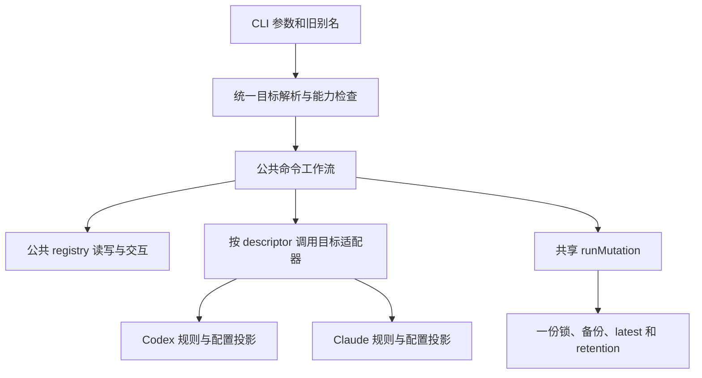

# 1.2.0 需求与抽象边界审查

审查日期：2026-10-13。源码基线：`1da0a60`，包版本 `1.1.3`。

审查对象是 [1.x roadmap 第 4 节](../agent-provider-switch-1.x-roadmap.md#4-120--the-target-descriptor) 的简单需求。本文记录全局源码与文档对照结果，不把尚未实现的 1.2.0 描述为完成。

## 已确认目标与当前范围

用户重申了三项目标：引入 target descriptor 和共享执行器；增加 `--target <id>` 并保留 `--codex` / `--claude` 别名；统一交互选择，让 `doctor/status/backups list` 根据描述符表处理目标。用户另行明确选择：保留现有正常操作语义，由适配器承载。

据此，本轮按统一源码与执行流程收敛，沿用现有两份 registry 文件及格式。统一物理存储没有被证明不可行，它只是本轮没有纳入的独立改动。用户已在最后一轮选择“是，按这组规则修订 roadmap”，下文规则已确认并同步到 roadmap，ADR 状态为 accepted。

作者个人使用且接受破坏性更新。保留当前行为是控制本轮重构范围的选择，不是对外兼容承诺。[1.1.x 的个人使用验收](agent-provider-switch-1.1.x-implementation-verification.md#结论与个人使用验收) 继续有效，已暂缓的边界完善不成为 1.2.0 的完成条件。

## 审查覆盖

- 执行入口、参数、命令注册、scope、guard、dispatch、两份 handler、输出 renderer。
- 六个公共动词的两套 app 服务、Claude compact、Codex setup/edit/import/export、状态与 doctor 编排。
- domain 记录与校验、身份匹配、Claude defaults/merge、TOML 解析与投影、错误与报告类型。
- storage registry/path/config/auth、共享工具配置、锁、备份、回滚与旧工具目录迁移。
- interaction、prompt runtime、Codex runtime probe，以及相关进程内和 E2E 测试的行为断言与接线。
- GLOSSARY、README、CLAUDE、两个 roadmap、产品/架构/命令/用法文档、1.0–1.1.x PRD/Design、评审与测试文档；早期 PRD/Design 用于核查被继承的决策。

需求结论来自源码与文档对照。文档修订后按仓库要求执行了类型检查与两套回归测试，结果见末节；测试使用现有隔离 fixtures，没有访问真实目标配置。

## 核心判断

公共流程可以只有一份。两种工具的 native 配置规则仍然不同，`target` 提供选择依据，适配器提供该目标的具体行为。

当前系统已经有 [TargetId 和 scope](../../src/domain/target.ts:10)、[执行上下文 targets](../../src/commands/types.ts:71) 和 [公共 mutation 的 target](../../src/app/run-mutation.ts:55)。缺少的是让这些值驱动公共实现：目前 [handler 仍提前转到整套 Claude handler](../../src/commands/handlers.ts:64)，之后继续执行 Codex 自己的分支。因此，再增加一个字段不能单独消除重复。



“每个动词有一份实现”与“所有源码挤进一个物理文件”不是同一完成标准。可以按现有层次保留小模块；需要消除的是重复的业务编排。

## 公共动词的边界

| 动词 | 公共流程 | 目标规则及现有证据 |
|---|---|---|
| add | 名称与 metadata、查重、注册表更新、事务 | [Codex](../../src/app/add-provider.ts:97) 同时准备 TOML 配置；[Claude](../../src/app/claude-add-provider.ts:65) 导入 settings 并按 defaults 保存 delta |
| list | 读集合、遍历、调用匹配和摘要策略 | [Codex](../../src/app/list-providers.ts:20) 使用 model_provider 路由；[Claude](../../src/app/claude-list-providers.ts:24) 使用 effective settings 匹配 |
| show | 查记录、metadata、调用展示策略 | [Codex](../../src/app/show-provider.ts:8) JSON 返回 apiKey；[Claude](../../src/app/claude-show-provider.ts:20) 默认隐藏完整 settings，reveal 返回 effective 与 overrides |
| current | 读 active settings、调用匹配策略、形成结果 | [Codex](../../src/app/get-current-profile.ts:8) 读取 TOML 当前路由；[Claude](../../src/app/claude-current.ts:17) 解析 defaults 并判断身份候选 |
| switch | 查记录、解析 effective view、生成变更计划、事务 | [Codex](../../src/app/switch-provider.ts:46) 修改 TOML 与 auth；[Claude](../../src/app/claude-switch-provider.ts:42) 整体写 settings |
| remove | 查记录、交互确认、生成删除计划、事务 | [Codex](../../src/app/remove-provider.ts:39) 删除唯一活动路由要求 switch-to；[Claude](../../src/app/claude-remove-provider.ts:16) 只删除注册记录 |

目标适配器可以提供操作专属的校验和变更计划。公共执行器负责选择适配器、编排公共步骤并应用计划，不能只调用旧的两套完整命令 handler，再称为已经统一。

## 原计划需要纠正或补清的地方

### 1. 抽象必须覆盖整个调用链

只合并 app 文件不够。其他公共编排仍依赖目标名称：

- [dispatch](../../src/commands/dispatch.ts:86) 解析 Codex 目录并处理报告路径策略；目标路径策略应来自适配器。
- [status](../../src/commands/handlers.ts:129) 与 [doctor](../../src/app/run-doctor.ts:54) 手动组合两套报告；公共编排应遍历已选择的 descriptor。
- [output](../../src/cli/output.ts:125) 按 Claude 分流，status/doctor 的文本也直接识别两个目标；目标摘要和 presenter 应经注册提供。
- [Codex selector](../../src/interaction/interactive.ts:24) 使用 prompt runtime，[Claude selector](../../src/commands/claude-handlers.ts:277) 另建流程并直接调用 inquirer；公共选择器应使用同一个可注入 runtime。
- [backup artifact ownership](../../src/domain/backups.ts:48) 和 roots 明写两个目标；新备份的归属与恢复影响应从声明的目标 artifacts/roots 取得。旧备份的历史名称识别可以集中保留，不要求将历史判断伪装成通用策略。

Codex CLI probe 是 [Codex 的额外诊断](../../src/app/run-doctor.ts:156)，不能变成所有目标都必须具备的能力。

### 2. scope 与 capability 不能混作一个字段

命令声明其选择策略、默认范围和是否需要显式选择；目标声明自身支持的操作。二者一起决定一次调用是否合法，guard、dispatch、help 与报告筛选应共享声明，避免各自维护名单。

1.2.0 沿用当前 21 条命令的实际支持范围：六个公共动词默认 Codex；Codex 专属命令只接受 Codex；compact 仍需显式选择 Claude；doctor/status/backups list 默认覆盖两目标、显式选择时收窄；prune/rollback/unlock 操作共享状态，拒绝目标选择参数。公共实现不会自动增加目标能力。

### 3. selector 必须先规范化再使用

建议 `--target codex` 与 `--codex` 完全等价，`--target claude` 与 `--claude` 完全等价；命令前后位置等价。相同目标重复指定归并为一次；不同目标拒绝；缺少值或未知目标使用 `INVALID_ARGUMENT`。多个 `--target` 值也遵循这个规则，不采用隐含的 last-wins。

[当前 parser](../../src/commands/args.ts:112) 在识别命令前只提取已知全局参数和布尔参数；新的 valued selector 必须在同阶段消费。[guard](../../src/commands/flag-guards.ts:109) 和 [compact](../../src/commands/claude-handlers.ts:243) 应检查规范化后的目标，不能继续依赖是否出现原始 `--claude`。

必须覆盖以下正常调用：

```text
aps --target claude list
aps list --target claude
aps add p --target claude --from-file settings.json --full
aps config compact --target claude --dry-run
aps doctor --target claude --json
```

`--target` 的价值是通用选择入口。旧文档声称布尔别名冲突检测必然需要平方复杂度并不准确：收集目标 id、去重并检查是否超过一个即可。

### 4. 明确事务与存储职责

公共 repo 负责读取、排序、查找和写回原始记录；target codec 负责记录合法性，adapter 负责 effective settings、matching 和 projection。共享读写实现不要求共享 native schema。

每次写操作声明实际受影响文件，通过现有 `runMutation()` 执行一次，适配器内部不嵌套该事务包装。共享 APS_HOME、锁、backups、latest、retention 保持一份；APS_CODEX_DIR/APS_CLAUDE_DIR 是目标配置根目录，不能称作两个 tool home。

Claude stored delta 与 effective settings 保持分开，普通读取、切换或删除其他记录不能把 effective view 展开写回 registry；[现有领域规则](../../src/domain/claude-providers.ts:30) 已说明这一点。

### 5. 展示策略不应由单一 secret path 推导

Codex 与 Claude 的 show/reveal 行为不同，正常重构保留各自策略。Claude 身份认证还有 API key/helper，[身份定义](../../src/domain/claude-identity.ts:41) 已包含多个位置；秘密位置不是完整的展示规则。

descriptor 应提供目标展示与脱敏策略，而不是给所有目标硬套同一个字段。公共 renderer 继续负责 envelope 与共享报告聚合，目标 presenter 负责目标专属字段。

### 6. “记录不同所以不能合并数据”不是技术限制

roadmap 第 2、7、8 节的这一论证过强。flat record 与 settings blob 可由有判别字段的 union 或公共 envelope 加目标 payload 表达；[glossary](../../GLOSSARY.md) 定义逻辑 registry，没有要求一个 target 对应一个物理文件。

本轮保留两个 registry 的理由应改成范围和成本：消除公共代码重复不需要同时迁移存储。如果将来合并数据，还需确定 `(target, name)` 身份、目标分区读写、import/export 范围、整文件恢复影响和一次迁移；只给现有 name→record value 加 target 无法容纳两个同名记录。这些是正常工作流决定，当前无需展开为新功能。

### 7. 验收按行为与扩展边界，不按文件数量

“第三个 target 只需一个文件”与后文的 descriptor、projection、能力声明、测试不一致。合理要求是新增目标声明、适配逻辑和测试，不复制公共命令流程，也不在中央执行器、选择器、诊断和输出中新增目标分支。静态类型、注册入口和文档的必要更新是正常扩展成本。

“所有现有 spec 原样通过”也不合理：[版本和源码路径断言](../../tests/release-contract.spec.js:108)、[旧 Claude routing 接线断言](../../tests/target-scope.spec.js:194) 会随版本与结构调整。应保留正常业务行为断言，允许调整路径、接线和版本；新增 selector 等价性和公共交互验证。最后运行类型检查、进程内套件和 E2E。

### 8. 全局文档基线与同步结果

- 审查时 [产品概述](../agent-provider-switch-product-overview.md:3) 与 [架构文档](../agent-provider-switch-technical-architecture.md:3) 开头仍标 0.2.1；前者偏 Codex，后者已有 1.1.3 内容。本轮已更新 current fact sources，并区分当前实现与 1.2.0 规划。
- 审查时 [CLAUDE parser 指导](../../CLAUDE.md) 仍描述已移除的 `resolveClaudeProviderName()` 与布尔参数吞值 workaround。本轮已修正当前解析机制和 Claude routing 说明。
- roadmap 的死代码清单不能直接照删：[doctor tests](../../tests/doctor-targets.spec.js:13) 正在使用 spawn setter/resetter。本轮已纠正这一项，并要求清理前按当前引用核查。
- README、usage、testing、正式 PRD/Design 在 1.2.0 发布时同步更新；当前发布版本保持 1.1.3。

## 已确认最终验收规则

1. 两目标的六个公共动词经过同一公共实现；记录/配置差异由适配器提供，不保留两套整命令 handler。
2. 所有 selector 与 guard 使用同一规范化结果，旧别名与 `--target` 等价；保留当前默认值、专属命令与共享命令范围。
3. 目标路径、记录规则、defaults、matching、projection、摘要、展示、额外诊断和 artifacts 归属声明集中；公共模块保留现有层次与纯 domain 的边界。
4. 交互统一使用现有 prompt runtime；各目标可以保留自己的输入字段与选择标签。
5. doctor/status 遍历所选描述符，out-of-scope 目标不读取、不运行 probe；backups list 保留来源与恢复影响的区别及历史备份读取。
6. 现有文件格式、正常业务语义、JSON 字段和含义保持；一次 mutation 只包一层共享事务，Claude delta 不被展开写回。
7. 新增目标增加声明、适配器和对应测试，不复制公共流程；本轮无需实现第三目标来证明这一点。
8. 新 selector 用例、类型检查与两套测试通过；允许调整测试接线；文档基线与清理清单按当前事实更新。

## 共识状态与下一步

已确认：描述符/共享执行器/通用 selector/统一交互与报告的方向、保留现有正常操作语义与数据格式，以及上述最终验收规则。

roadmap 已同步目标、公共与目标专属职责、selector 规则、事务边界、扩展与测试验收，以及存储合并和别名冲突复杂度的论证；[ADR](../adr/0001-share-provider-workflows-through-target-adapters.md) 为 accepted，glossary 增加 Provider name 与 Target capability。旧 roadmap 保留历史编号，其现行存储边界说明同步修正。

正式 [1.2.0 PRD](../PRD/agent-provider-switch-prd-v1.2.0.md) 与 [Technical Design](../Design/agent-provider-switch-v1.2.0-design.md) 已根据上述确认规则完成，定义需求、适配器接口、模块职责、实施顺序及 A01–A10 验收追踪。审查、需求和设计文档已完成；1.2.0 业务实现仍待开始，当前包版本保持 1.1.3。

## 文档修订后验证

Windows、Node `20.19.5`，通过 `fnm exec --using=20.19.5 cmd /c` 执行 npm/npx 命令。两个会重建 dist 的测试套件顺序运行。

| 检查 | 命令 | 结果 |
|---|---|---|
| 类型检查 | `npx tsc --noEmit` | 通过，exit 0 |
| 构建与进程内测试 | `npm test` | 通过，exit 0；runner 成功时不打印用例列表 |
| 构建与 E2E | `npm run test:e2e` | 41 passed / 0 failed / 0 skipped，exit 0 |
| diff 格式 | `git diff --check` | 通过 |
| 文档引用与空白 | 核查 8 份变动文档的 64 个本地文件链接与行尾空白 | 引用文件全部存在，空白检查通过 |

验证基线仍是当前 `1.1.3` 程序；1.2.0 实施后按上述已确认规则另行验收。
